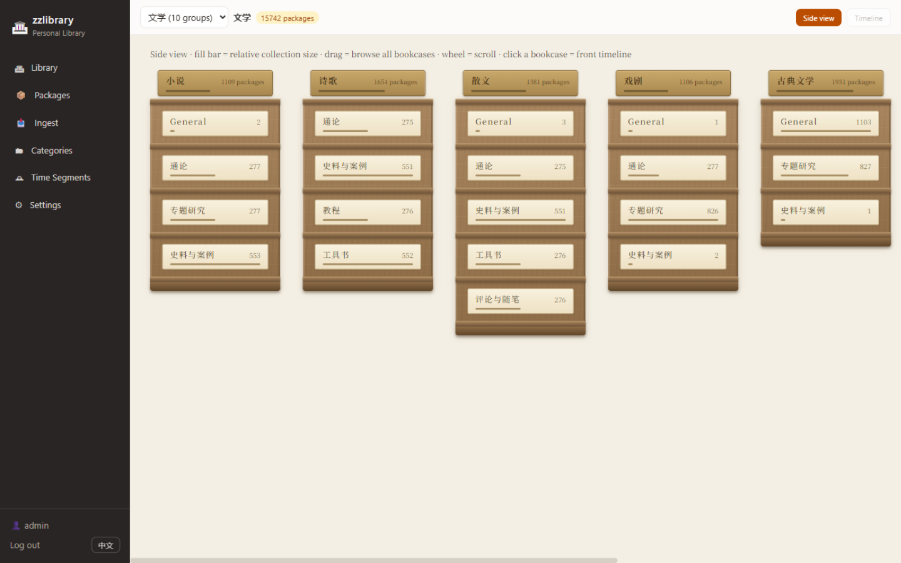
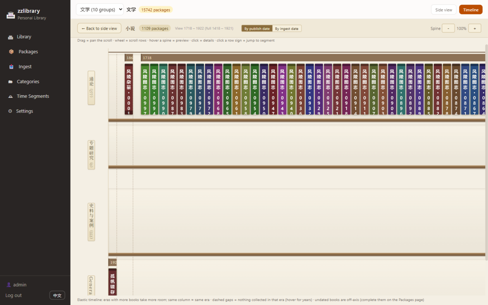

# zzlibrary · Personal Library

[](../../actions/workflows/ci.yml)
[](LICENSE)
[](README.zh-CN.md)

**Your documents, organized as a real library — not a folder tree.**

zzlibrary is a self-hosted personal library: your documents shelved like real books — classification decides which bookcase, era decides where on the shelf, and every **package** (a "bound volume" holding any number of files in any format) stands as one spine. Browse your collection the way you browse a library, then read in place — EPUB, PDF, TXT, Markdown, HTML, docx, images, audio and video, with per-file reading progress that follows you.



## Features

File managers make you *remember where things are*. zzlibrary makes your collection *legible at a glance*:

- **Virtual bookshelf** — two views over the same collection: a side view of all your bookcases at a glance, and, inside any bookcase, a timeline scroll where spines line up by era — same-era books align across rows, busy eras take more room. A package can sit on multiple shelves at once via multiple classification paths.
- **Read everything in place** — built-in reader with resume: EPUB (CFI), PDF, TXT (encoding auto-detect), Markdown/HTML/docx (sandboxed), images, audio/video players. One file row, one interaction contract.
- **Local-first** — your data lives on your machine, in one folder: a SQLite database + your original files, byte-identical, never lock-in. No account, no cloud, no telemetry.
- **Own your safety net** — one-click full-library backup to any local folder (consistent snapshot + all files). Copy the data folder and you've moved the library.
- **Fast at scale** — FTS5 full-text search, SQL-aggregated shelf overview, lazy-loaded racks. Tested with 100,000 packages.



## Quick start

**Docker (recommended for self-hosters):**

```bash
docker run -d --name zzlibrary -p 8000:8000 \
  -v /path/to/zzlibrary-data:/data \
  ghcr.io/wenobug/zzlibrary:latest
```

**Or a plain zip (no Docker needed):** grab the latest [`zzlibrary-server-*.zip`](../../releases), unzip, install [Node.js ≥ 22.5](https://nodejs.org), double-click `start-windows.bat` (or `./start-linux.sh`). Open `http://localhost:8000`, default account `admin / zzlibrary`.

Every device on your LAN (phone, tablet) can open the same library at `http://<server-ip>:8000`.

## Deployment

### Where the data lives / backup

- Everything sits in one folder: `<unzipped>/data/` (metadata DB `library.db`, original files `files/`, covers & spines `art/`)
- **Backup = copy the whole data folder**, or use in-app *Settings → Back up the library* to write a consistent snapshot anywhere (external drives included)
- Docker: everything lands in the mounted `/data` volume — back up that volume
- Upgrading: stop the server → overwrite `dist-server/` and `web/` from the new unzipped release (leave `data/` untouched) → start again

### Environment variables

| Variable | Default | Notes |
|---|---|---|
| `ZZLIB_DATA_DIR` | `<unzipped>/data` | Data directory (can point to another disk) |
| `ZZLIB_PORT` / `PORT` | `8000` | Listen port |
| `ZZLIB_USERNAME` / `ZZLIB_PASSWORD` | `admin` / `zzlibrary` | Login (**change the password**) |
| `ZZLIB_ROOT` | auto | App root (parent of `dist-server`; rarely needed) |
| `ZZLIB_WEB_DIST` | auto | Web UI directory (rarely needed) |

### ⚠️ Security notes

- The server is **single-account session auth**, aimed at personal/home LAN use — **do not expose it to the public internet unprotected**
- **Change the default password immediately** after first start: set `ZZLIB_PASSWORD` (a `pbkdf2$iterations$salt$hash` value is supported)
- For remote access prefer **Tailscale/WireGuard** (encrypted tunnel, zero public exposure, no filing/registration needed)
- If you must expose it publicly: HTTPS reverse proxy (Caddy/Nginx) + a strong password + IP allowlist — at your own risk

### FAQ

- **Port already in use**: set `ZZLIB_PORT=8001` or free the port
- **Phone can't reach it**: same network? Is the port allowed through the firewall? (On Windows, allow it on *Private networks* when prompted)
- **Forgot the password**: start with `ZZLIB_PASSWORD=<new>` to reset it

## Roadmap

- **1.1** — Desktop apps (Windows/macOS, Tauri)
- **1.2** — Mobile apps (iOS/iPadOS/Android via Capacitor; HarmonyOS shell)
- **Later** — Cross-device sync & backup to **your own cloud** (WebDAV / S3-compatible), local space release with transparent re-fetch

1.0 is deliberately offline-first: no cloud, no accounts, your data stays on your machine.

## Development

```bash
npm install                # Node >= 24 (uses built-in node:sqlite)
npm test -w @zzlibrary/core && npm test -w @zzlibrary/server
npm run dev -w @zzlibrary/server    # API server on :8000
npm run dev -w @zzlibrary/web       # web UI on :5173 (proxies /api)
npm run build:release               # bundled server + release zip
```

Monorepo: `packages/core` (pure-TS domain logic shared by every future client), `packages/server` (Hono + node:sqlite + sharp), `packages/shared` (types + API client), `web` (React 19 + Vite + Tailwind).

## License

[AGPL-3.0](LICENSE) — free to use, study, modify and self-host. Closed-source forks offered as a service must open their source. 中文说明见 [README.zh-CN.md](README.zh-CN.md).
