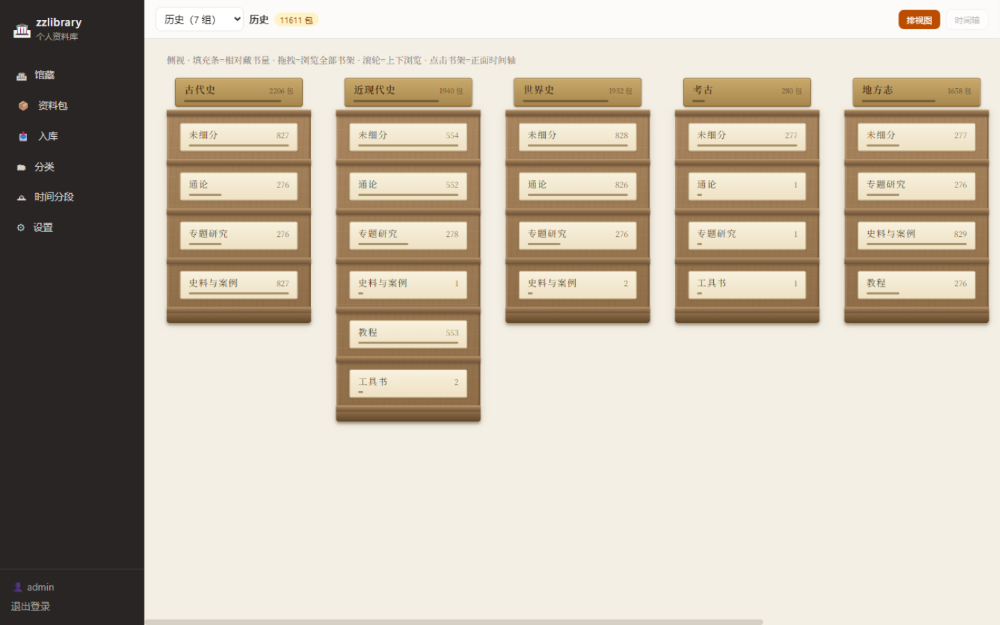
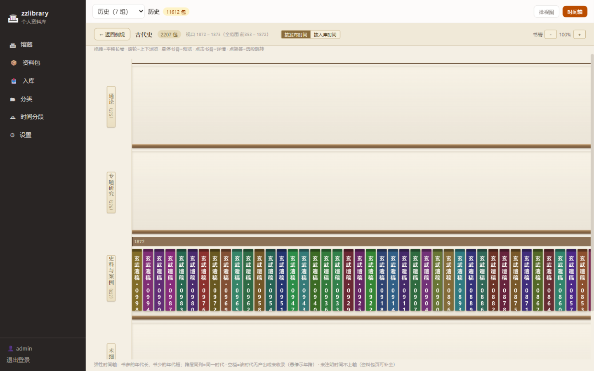

# zzlibrary · 个人资料库

[](../../actions/workflows/ci.yml)
[](LICENSE)
[](README.md)

**把你的资料放进一座自己的图书馆——而不是一棵文件夹树。**

zzlibrary 是自托管的个人资料库：资料像真书一样上架——分类决定它在哪座书架，年代决定它在架上排在哪儿，每个**资料包**（一份可装任意数量、任意格式文件的「合订本」）就是一格书脊。像逛图书馆一样浏览馆藏，随手抽一本原地开读：EPUB、PDF、TXT、Markdown、HTML、docx、图片、音频、视频，逐文件的阅读进度自动断点续读。



## 特色

- **虚拟图书馆书架**——同一馆藏两种看法：侧视图总览一排排书架的布局与体量；点进书架变成沿年代铺开的长卷，同一时代的书脊上下对齐，书多的年代自然更长。资料包可挂多条分类路径，同时出现在多个书架。
- **全格式原地阅读**——内置阅读器带断点续读：EPUB（CFI 定位）、PDF、TXT（编码自动探测）、MD/HTML/docx（沙箱渲染）、图片、音视频。文件行全应用单一形态：可读即读、不可读另存。
- **本地优先**——数据全在本机一个目录：SQLite 元数据库 + 原件文件（字节原样、永不绑架）。无账号、无云、无遥测。
- **安全网在你手里**——一键「备份整库」到任意本机目录（一致性快照 + 全部文件）；整个数据目录拷走就是搬家。
- **大规模也快**——FTS5 全文搜索、SQL 聚合书架概览、书架懒加载。十万包压测验证。



## 快速开始

**Docker（自托管推荐）：**

```bash
docker run -d --name zzlibrary -p 8000:8000 \
  -v /你的数据目录:/data \
  ghcr.io/wenobug/zzlibrary:latest
```

**或 zip 直跑（不需要 Docker）**：下载最新的 [`zzlibrary-server-*.zip`](../../releases)，解压，安装 [Node.js ≥ 22.5](https://nodejs.org)，双击 `start-windows.bat`（或 `./start-linux.sh`）。浏览器打开 `http://localhost:8000`，默认账号 `admin / zzlibrary`。

局域网内的手机/平板用 `http://<服务器IP>:8000` 访问同一座馆。

## 部署

部署细节、环境变量与**安全须知**（改默认密码；勿公网裸奔，远程访问推荐 Tailscale/WireGuard 组网）见 [DEPLOY.md](DEPLOY.md)：

| 变量 | 默认 | 说明 |
|---|---|---|
| `ZZLIB_DATA_DIR` | `<解压目录>/data` | 数据目录（可指到别的盘） |
| `ZZLIB_PORT` | `8000` | 监听端口 |
| `ZZLIB_USERNAME` / `ZZLIB_PASSWORD` | `admin` / `zzlibrary` | 登录账号（**请改密码**） |

## 路线图

- **1.1** 桌面应用（Windows/macOS，Tauri）
- **1.2** 移动应用（iOS/iPadOS/Android，Capacitor；鸿蒙壳）
- **后续** 跨设备同步/备份到**你自己的云**（WebDAV / S3 兼容），本地空间释放 + 透明取回

1.0 刻意做成离线优先：无云、无账号，数据只在你自己机器上。

## 开发

```bash
npm install                # Node >= 24（用内置 node:sqlite）
npm test -w @zzlibrary/core && npm test -w @zzlibrary/server
npm run dev -w @zzlibrary/server    # API 服务 :8000
npm run dev -w @zzlibrary/web       # web 界面 :5173（代理 /api）
npm run build:release               # 服务端 bundle + 发布 zip
```

Monorepo：`packages/core`（纯 TS 域核心，未来所有端共用）、`packages/server`（Hono + node:sqlite + sharp）、`packages/shared`（类型 + API 客户端）、`web`（React 19 + Vite + Tailwind）。

## 许可

[AGPL-3.0](LICENSE)——自由使用、学习、修改与自托管；闭源改版对外提供服务须开源。English readme: [README.md](README.md).
